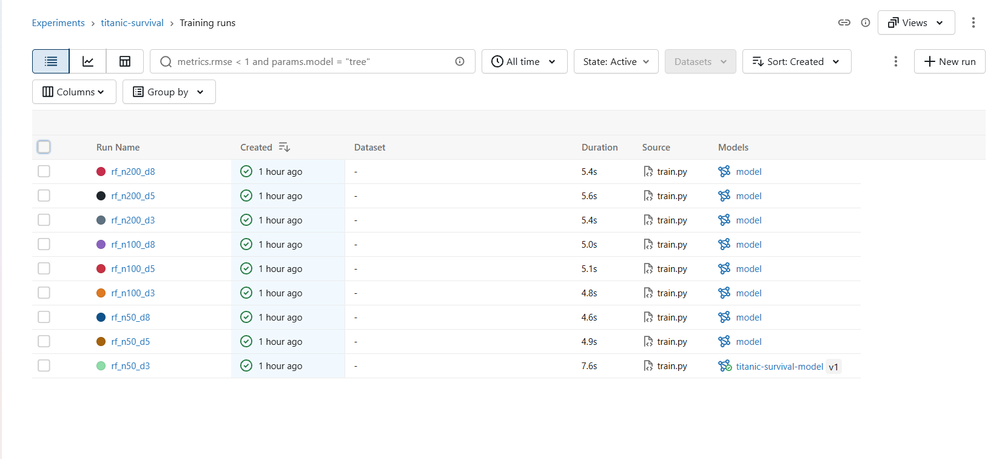
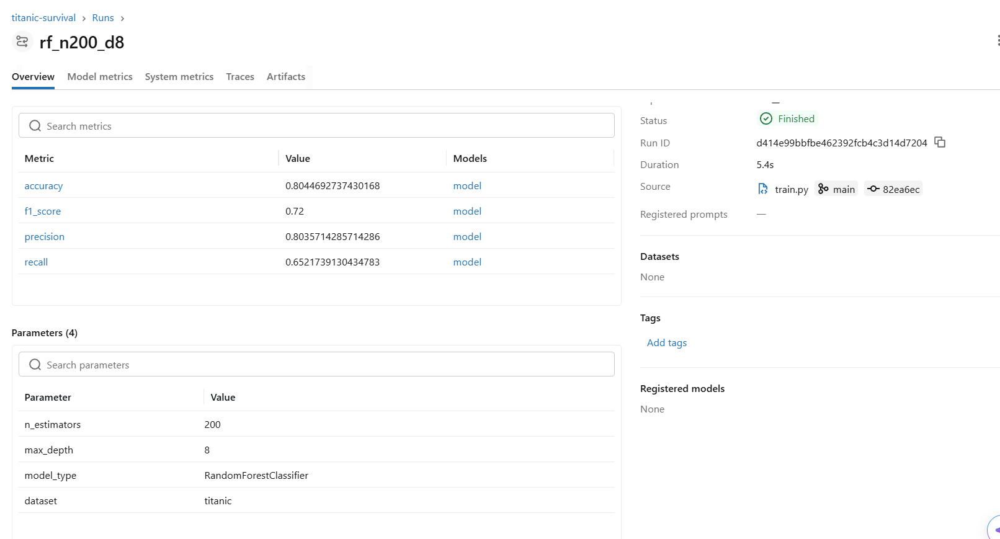
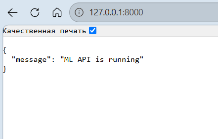
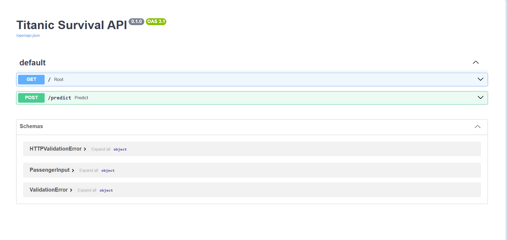
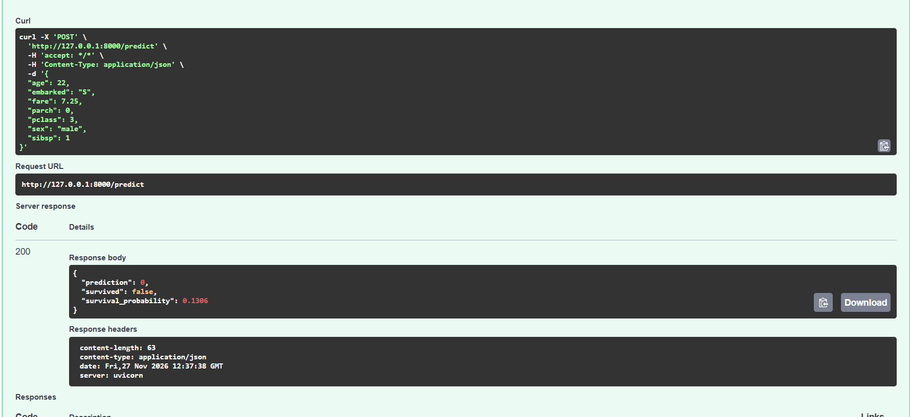
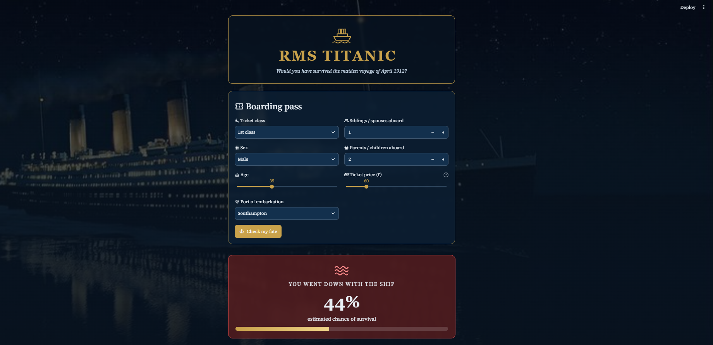
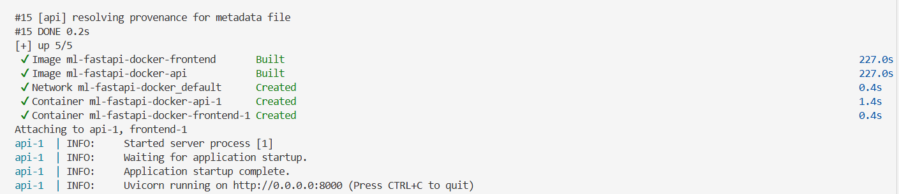

# Titanic Survival Prediction: ML model with FastAPI, Docker, Streamlit and MLflow

An end-to-end machine learning project: a classifier is trained on the Titanic dataset,
tracked and registered with **MLflow**, served as a REST API with **FastAPI**,
used through a **Streamlit** web interface, and packaged with **Docker**.

## Overview

```
Streamlit UI  --->  FastAPI (/predict)  --->  model.joblib (sklearn Pipeline)
                                                    ^
                      train.py  ---(best run)-------+
                          |
                          +--->  MLflow (experiment tracking + model registry)
```

## Tech stack

Python, scikit-learn, pandas, FastAPI, Uvicorn, Streamlit, MLflow, Docker, Docker Compose.

## Project structure

```
ml-fastapi-docker/
├── main.py              # FastAPI application
├── train.py             # trains models, logs to MLflow, saves model.joblib
├── app.py               # Streamlit frontend
├── model.joblib         # saved best model (sklearn Pipeline)
├── requirements.txt     # Python dependencies
├── Dockerfile           # container for the API
├── docker-compose.yml   # API + Streamlit together
├── assets/              # background image for the frontend
├── .streamlit/          # Streamlit theme
├── screenshots/         # images used in this README
└── README.md
```

## Dataset and model

- **Dataset:** Titanic (loaded with seaborn). Target: `survived` (0 / 1).
- **Features:** `pclass`, `sex`, `age`, `sibsp`, `parch`, `fare`, `embarked`.
- **Model:** Random Forest inside a scikit-learn `Pipeline`
  (median / most-frequent imputation, one-hot encoding, classifier).
  The whole pipeline is saved, so the API accepts raw passenger data.

## MLflow: experiment tracking and model registry

`train.py` creates the experiment `titanic-survival` and runs 9 experiments
(`n_estimators` in 50 / 100 / 200, `max_depth` in 3 / 5 / 8).

For every run it logs:

| What | Details |
|---|---|
| Parameters | `n_estimators`, `max_depth`, model type, dataset |
| Metrics | accuracy, F1-score, precision, recall |
| Artifacts | the MLflow model and the `model.joblib` file |

The run with the best F1-score is saved as `model.joblib` (used by the API) and registered
in the **MLflow Model Registry** as `titanic-survival-model` (version assigned automatically,
alias `champion`).

```bash
python train.py
mlflow ui --backend-store-uri sqlite:///mlflow.db
```
Open http://127.0.0.1:5000.

### Results

All 9 runs were evaluated on the same hold-out test set (20% of the data, 179 passengers,
stratified split, `random_state=42`).

| Run | n_estimators | max_depth | Accuracy | F1-score |
|---|---|---|---|---|
| rf_n50_d3 | 50 | 3 | 0.8101 | **0.7258** |
| rf_n50_d5 | 50 | 5 | 0.8045 | 0.7009 |
| rf_n50_d8 | 50 | 8 | 0.8045 | 0.7244 |
| rf_n100_d3 | 100 | 3 | 0.8101 | **0.7258** |
| rf_n100_d5 | 100 | 5 | 0.8101 | 0.7069 |
| rf_n100_d8 | 100 | 8 | 0.8045 | 0.7200 |
| rf_n200_d3 | 200 | 3 | 0.8101 | **0.7258** |
| rf_n200_d5 | 200 | 5 | 0.8101 | 0.7069 |
| rf_n200_d8 | 200 | 8 | 0.8045 | 0.7200 |

**Best model:** `rf_n50_d3` (`n_estimators=50`, `max_depth=3`) with
accuracy = **0.81** and F1-score = **0.73**. Three runs share the best F1-score;
the first one (the smallest forest) is selected, and it is saved as `model.joblib`
and registered in the Model Registry.

**Observations:**
- A shallow forest (`max_depth=3`) gives the best F1-score, deeper trees do not help
  and slightly overfit.
- Increasing the number of trees from 50 to 200 does not change the result.
- Accuracy differs between runs by one passenger (145 vs. 144 correct answers out of 179),
  so the test set is too small to tell these configurations apart reliably.
  Cross-validation would give a more stable comparison.

### Screenshots

**Experiment with all runs**



**Run details: parameters and metrics**




## FastAPI service

| Method | Endpoint | Description |
|---|---|---|
| GET | `/` | health check |
| POST | `/predict` | returns the prediction for one passenger |
| GET | `/docs` | interactive Swagger documentation |

Example request to `/predict`:
```json
{
  "pclass": 3,
  "sex": "male",
  "age": 22,
  "sibsp": 1,
  "parch": 0,
  "fare": 7.25,
  "embarked": "S"
}
```
Example response:
```json
{
  "prediction": 0,
  "survived": false,
  "survival_probability": 0.12
}
```

### Screenshots (local run)







## Streamlit frontend

A web form (boarding pass style) that sends the passenger data to the FastAPI `/predict`
endpoint and shows the survival probability.



## How to run

### 1. Locally

```bash
python -m venv venv
venv\Scripts\activate            # Windows
source venv/bin/activate         # Mac / Linux

pip install -r requirements.txt
python train.py                  # trains models, creates model.joblib

# terminal 1
uvicorn main:app --port 8000
# terminal 2
streamlit run app.py
```
- API docs: http://localhost:8000/docs
- Frontend: http://localhost:8501

### 2. With Docker (API only)

```bash
docker build -t titanic-api .
docker run -p 8000:8000 titanic-api
```
Another port on your machine can be used by changing the left number,
e.g. `-p 8080:8000`.



### 3. With Docker Compose (API + Streamlit)

```bash
docker compose up --build
```
- API: http://localhost:8000/docs
- Frontend: http://localhost:8501

## Notes

- `model.joblib` must exist before building the image, so run `python train.py` first.
- Library versions in `requirements.txt` are pinned so that the model is loaded
  in Docker with the same scikit-learn version it was trained with.
- The MLflow database (`mlflow.db`) and `mlruns/` are not stored in Git.
  Use `mlflow ui --backend-store-uri sqlite:///mlflow.db` after running `train.py`.